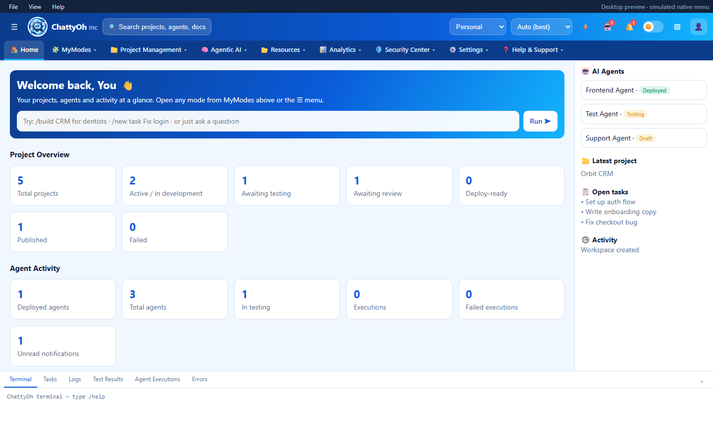
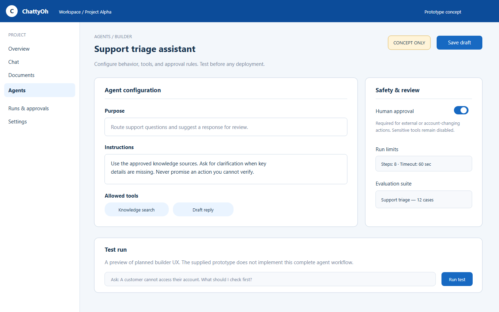
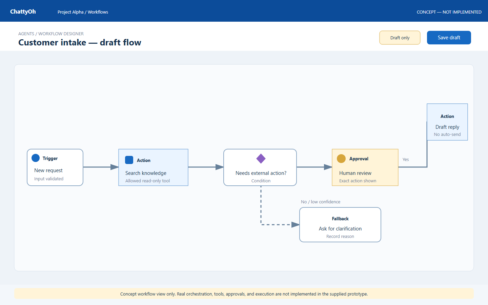

# ChattyOh

ChattyOh is an agent-assisted project workspace intended to take an idea from conversation through planning, documentation, agent runs, and review—with people retaining control of approvals and release gates.

This package brings the existing product and backend planning documents together with the requested documentation site, project structure, and prototype artifacts. **The backend and many integrations are planned, not implemented.** The current frontend is a prototype; see the platform audit in `src/backend plan/`.

## Project layout

```text
ChattyOh/
├── .github/workflows/       Documentation build and deployment
├── docs/                    MkDocs source and architecture assets
├── prototype/               User-flow PDF and early wireframes
├── screenshots/             UI showcase images (prototype/concept)
├── src/
│   ├── frontend/             Existing HTML prototype and desktop shell
│   └── backend plan/         Existing backend and delivery documentation
├── .gitignore
├── mkdocs.yml
└── README.md
```

## Preview the frontend prototype

Open `src/frontend/index.html` in a current desktop browser. It is a standalone HTML prototype and does not require a backend. The companion Electron shell is under `src/frontend/desktop-shell/`.

The interface includes simulated or incomplete features. Do not treat prototype actions, integrations, or local storage as production behavior. The full audit and mitigation plan are in `src/backend plan/`.

## UI previews

The home image is captured from the supplied frontend prototype. The agent-builder and workflow images are labeled concept screens; those complete experiences are not implemented in the prototype.

| Home prototype | Agent builder concept | Workflow concept |
|---|---|---|
|  |  |  |

## Build the documentation site

```powershell
python -m pip install mkdocs
mkdocs build --strict --config-file mkdocs.yml
```

The generated site is written to `site/` and is excluded from version control.

## Source documents

The complete pre-existing documentation pack (PRD, SRS, architecture, OpenAPI contract, security, test plans, threat model, roadmap, and traceability materials) is preserved under `src/backend plan/chattyoh-docs/`. The source documents remain drafts and retain their original wording and filenames.
