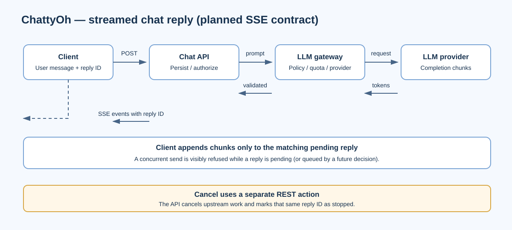

# API design

**Status:** Draft contract. This is a planned API; the backend is not implemented in the supplied prototype.

The authoritative OpenAPI 3.1 file is `src/backend plan/chattyoh-docs/packages/contracts/openapi.yaml`. It defines 55 operations with stable `operationId` values, role requirements, and links to SRS requirements and security controls. Update that contract first, then regenerate clients and implement the server.

## Transport and conventions

- HTTPS REST under `/v1`; JSON request and response bodies.
- Server-Sent Events for chat reply streaming. The draft does not define a WebSocket API.
- OIDC-backed sessions: HttpOnly session cookies for web; bearer tokens for desktop/mobile shells, subject to the final identity design.
- Tenant and user identity come from the authenticated session. A workspace in the path must match an active membership.
- Cursor pagination with a maximum `limit` of 100; creating POST requests use `Idempotency-Key`.
- Request validation rejects unknown fields; text fields are capped at 200,000 characters and imports at 2,000 records.
- Common error body: `{ "code": "...", "message": "...", "details": {}, "requestId": "..." }`. Return 404 for inaccessible tenant-owned IDs to avoid revealing their existence.
- Gated status fields are read-only. Action endpoints enforce rules and return `409` with gate details when a transition is refused.

## Resource groups

| Area | Representative operations |
|---|---|
| Identity | `GET /v1/me`, session list/revoke, MFA enrollment |
| Workspaces | List/create workspaces; manage workspace members and roles |
| Projects and tasks | CRUD/archive projects, create and update project tasks, request lifecycle transitions |
| Chat | Create/list conversations, send messages, stream/cancel replies |
| Documents | Create/update documents, read versions, submit for review, approve or restore a version |
| Agents | Manage definitions, run tests, request approval, deploy, execute, pause/resume, inspect run history |
| Audit and notifications | Read authorized audit events; list and mark notifications |
| Data portability | Validate/import, export, backup, and restore versioned workspace data |

The exact paths, schemas, operation IDs, auth requirements, and examples are maintained in the OpenAPI file. The table above is an orientation, not a replacement contract.

## Streaming and cancellation

1. The client sends a message request; the API stores the user message and creates a pending reply with a unique ID.
2. The client opens the reply's SSE stream. Events carry the reply ID and ordered text/status updates.
3. The client updates only that reply record. A second send while one reply is pending is refused with a visible `409` (or queued by a later product decision).
4. The client cancels through a separate REST operation; the API cancels the upstream provider request and finalizes the reply state.

## Security and reliability

Authorize every request server-side and scope every query and job to its tenant. Sensitive actions require step-up authentication or human approval according to workspace policy. Never return credentials to the model or client. Audit role changes, approvals, imports/exports, and lifecycle actions. Tool and model calls must obey configured time, step, and cost limits.

The OpenAPI contract and associated test, threat, security, and traceability documents are part of the backend plan pack. They are draft artifacts and should be validated and approved before implementation or external publication.
