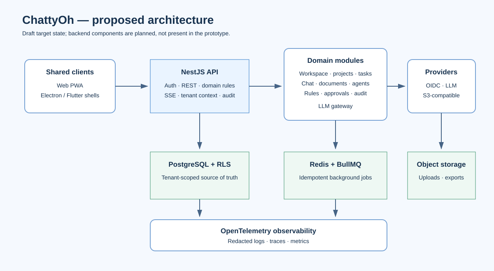
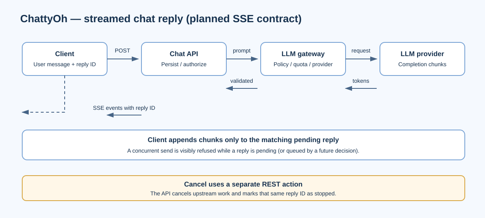

# Architecture

**Status:** Proposed architecture, draft for review. The only implemented application in this package is the existing frontend prototype; the server-side components below are plans.

## System shape

ChattyOh uses a shared web UI hosted directly in a browser or inside thin Electron and Flutter shells. Clients call a NestJS modular-monolith API over HTTPS. The API owns identity, tenant authorization, domain rules, persistence, agent execution, and audit records. LLM requests go through a policy- and quota-aware gateway; background agent work is queued.

## Main components

| Component | Responsibility |
|---|---|
| Web UI and platform shells | Shared product interface; platform-specific file, secure-storage, and lifecycle capabilities stay behind a small bridge. |
| API / domain modules | Identity, workspace, project/task, chat, documents, agents, audit/notifications, and import/export. |
| Rules module | Server-side authorization, lifecycle gates, approvals, and other domain invariants. |
| LLM gateway | Provider abstraction, tenant context, quotas, safety checks, output validation, and usage records. |
| Workers | Idempotent background agent jobs that carry tenant and entity IDs from creation through completion. |
| PostgreSQL | Source of truth for tenant-scoped entities; row-level security is defense in depth. |
| Redis / BullMQ | Background queue and bounded run coordination. |
| Object storage | Document uploads, exports, and backups. |
| Observability | Structured logs, traces, and metrics with secrets and personal content redacted. |

## Request and messaging flow

CRUD and state-changing operations use REST. Chat replies use **Server-Sent Events (SSE)** rather than WebSockets: the server streams one-way reply updates, while a separate REST action cancels a pending reply. Each reply has its own immutable ID so chunks cannot be attached to a different message.

State transitions such as approving a document or advancing a project are action endpoints. The server loads current state by ID, checks the actor's role and applicable gates, writes the transition, and appends an audit event in one transaction. Clients do not write gated status fields directly.

## Deployment and quality attributes

The plan targets local development with seeded data and a mock gateway, ephemeral CI infrastructure, production-like staging, and a production environment with managed PostgreSQL, private networking, secret storage, and horizontally scaled API/worker processes. Provider, identity, cloud, and compliance choices remain open decisions.

Key targets from the draft SRS include CRUD API p95 latency of 300 ms, 99.5% monthly MVP availability, 4-hour RTO, 15-minute RPO, WCAG 2.2 AA for core journeys, and no silent write failures. These are proposed requirements, not measured production guarantees.

## Architecture decisions

- Start with a modular monolith; extract services only when a boundary requires it.
- Treat the OpenAPI contract as the source for client types and contract tests.
- Use immutable IDs and tenant IDs for relationships; enforce tenant isolation in application rules and PostgreSQL RLS.
- Route every model call through the LLM gateway; keep provider credentials off clients.
- Make background jobs idempotent and bind them to the tenant and entity that created them.
- Use IndexedDB only as a versioned client cache; the planned server is authoritative.
- Keep desktop/mobile shells thin and share the web UI.

The detailed architecture, ADRs, migration plan, security design, and quality scenarios are retained in `src/backend plan/chattyoh-docs/docs/03-architecture.md`.
