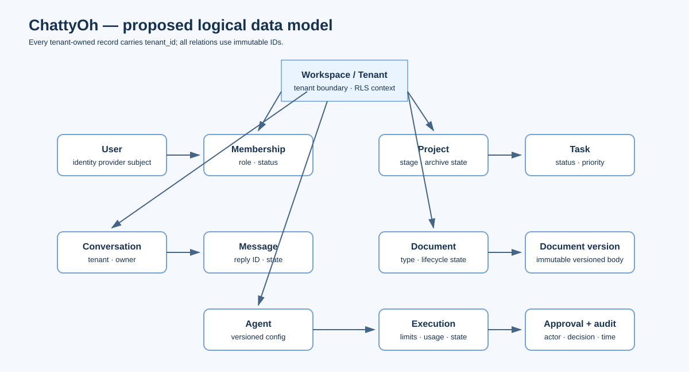

# Data model

**Status:** Proposed logical schema. The backend and persistent database are not included in the current frontend prototype.

## Entity relationships

The core model is tenant-scoped. A workspace is the tenant boundary; memberships connect users to workspaces and roles. Projects contain tasks. Conversations contain messages. Documents have immutable version records. Agents have executions, with approvals attached to gated steps. Audit events record security- and integrity-relevant actions.

## Core entities

| Entity | Key fields and relationships |
|---|---|
| User | `id`, identity-provider subject, profile fields, timestamps |
| Workspace | `id`, name, status, schema version, timestamps |
| Membership | `id`, `tenant_id`, `user_id`, role, status; unique per tenant/user |
| Project | `id`, `tenant_id`, name, stage, archive timestamp, creator |
| Task | `id`, `tenant_id`, `project_id`, title, status, priority, due date |
| Conversation | `id`, `tenant_id`, owner, title, status |
| Message | `id`, `tenant_id`, `conversation_id`, role, content, reply/status metadata |
| Document | `id`, `tenant_id`, type, title, lifecycle state, current version |
| DocumentVersion | `id`, `tenant_id`, `document_id`, version number, body, author, approval metadata |
| Agent | `id`, `tenant_id`, name, immutable config/version reference, status |
| Execution | `id`, `tenant_id`, `agent_id`, input/output, state, limits, usage, timestamps |
| Approval | `id`, `tenant_id`, `execution_id` or `document_version_id`, decision, actor, timestamps |
| AuditEvent | `id`, `tenant_id`, actor, action, resource ID/type, redacted metadata, timestamp |
| Notification | `id`, `tenant_id`, recipient, event reference, read timestamp |

Every tenant-owned row carries an immutable `id`, `tenant_id`, `created_at`, `updated_at`, and applicable `schema_version`. Relationships use IDs, never display names. Documents, projects, and agents support recoverable archive/soft-delete behavior where specified.

## Integrity and isolation

- Enforce membership and role authorization in the domain layer on every request.
- Apply PostgreSQL row-level security using tenant context established by trusted server middleware.
- Add tenant predicates to background job payloads and re-establish tenant context in workers.
- Use foreign keys and tenant-aware uniqueness constraints so a row cannot reference another tenant's entity.
- Change gated lifecycle states only through server actions that validate current state and append an audit event transactionally.
- Validate stored and imported JSON against versioned schemas; report failed writes and preserve recoverable data rather than silently discarding it.

## Indexing and query patterns

Planned indexes should support workspace membership lookup, tenant-scoped listing, project/task filtering, conversation message ordering, document version retrieval, agent execution history, and audit chronology. Candidate composite indexes include:

- `(tenant_id, updated_at, id)` for recent entity lists.
- `(tenant_id, project_id, status, due_at)` for task filters.
- `(tenant_id, conversation_id, created_at, id)` for message history.
- `(tenant_id, document_id, version_number)` with unique version numbers per document.
- `(tenant_id, agent_id, created_at, id)` for execution history.
- `(tenant_id, created_at, id)` for audit timelines.

Index definitions should be confirmed against measured query plans before release. Sensitive content and secrets must not be copied into analytics indexes or audit metadata.

## State and retention

The server is the planned source of truth. IndexedDB is a versioned local cache, not a secrets store. Drafts and pending replies have explicit states; status changes are server-derived. Use idempotency keys for retryable writes and jobs. Retention, export, erasure, backup, and restore behavior must follow the workspace privacy policy and the controls in the backend plan.

The requirements and architecture sources are `src/backend plan/chattyoh-docs/docs/02-srs.md` and `03-architecture.md`; this page summarizes their logical entities without claiming an implemented database schema.
