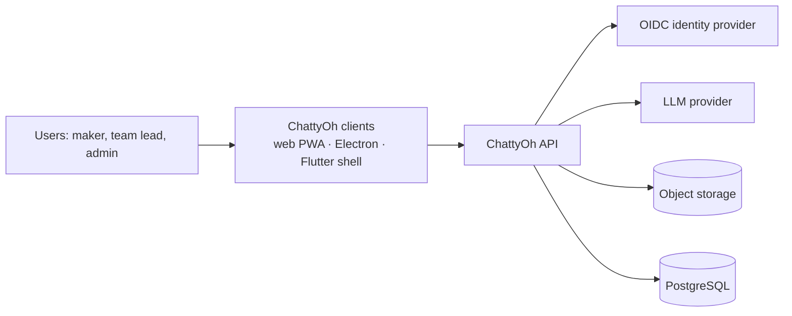
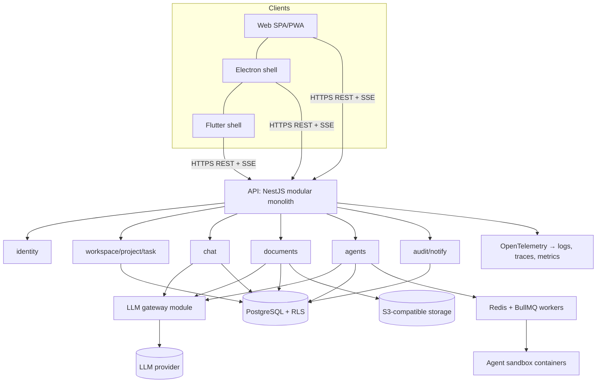
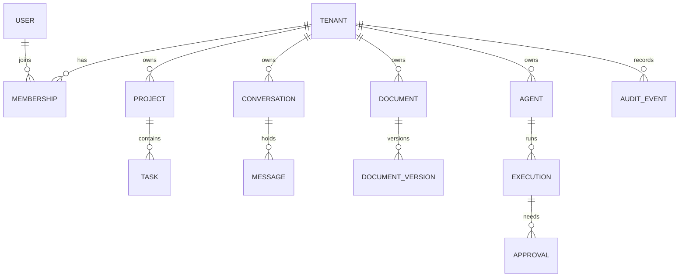

# 03 — Architecture

**Project:** ChattyOh Inc · **Version:** 0.1 (draft) · **Owner:** Tech Lead · **Status:** Draft
**Upstream:** `02-srs.md`, `14-poc-report.md` · **Downstream:** `04-security-measures.md`, `05-openapi.md`, `10-release-deployment-plan.md`

## 1. Context

## 2. Containers

## 3. Modules and responsibilities

| Module | Responsibility | Key requirements |
|---|---|---|
| identity | OIDC login, sessions, MFA step-up, role lookup | SRS-FR-AUTH-001…003 |
| workspace | Tenants, memberships, roles, projects, tasks, gates (rules module) | SRS-FR-WS-001…005, SRS-FR-TASK-001/002 |
| chat | Conversations, messages, streaming, commands | SRS-FR-CHAT-001…005 |
| documents | Documents, versions, generation, approval workflow | SRS-FR-DOC-001…004 |
| agents | Agent definitions, tests, deployments, runs, approvals, limits | SRS-FR-AGENT-001…006 |
| audit/notify | Append-only audit events, notifications | SRS-FR-AUDIT-001/002 |
| io | Export, import, backup, restore | SRS-FR-IO-001…003 |
| llm-gateway | Provider abstraction, prompt assembly, quotas, output validation | SEC-C-08, SEC-C-09 |
| rules | Domain rules: gates, approvals, permissions (single source) | SRS-NFR-INT-01 |

## 4. Data model (core)

Rules: every row has `tenant_id`; relations use immutable IDs; PostgreSQL row-level security restricts rows to the current tenant; `schema_version` on stored documents; soft-delete fields on projects, documents and agents.

## 5. Key flows

**Streaming chat reply (SRS-FR-CHAT-002/003/005).**
1. Client posts a message; API stores it, creates a *pending reply* record with its own ID, and opens an SSE stream.
2. The chat module asks the gateway for a completion (tenant context attached).
3. Chunks stream to the client, tagged with the reply ID; the client updates only that message.
4. On completion or Stop, the reply is finalized and the upstream request is cancelled if still open.

**Gated action (SRS-FR-WS-004, SRS-FR-AGENT-003).** The client calls an *action* endpoint; the rules module loads current state by ID, checks permissions and gates, then writes the change and an audit event in one transaction. Clients cannot write gated fields directly.

**Background job with tenant context (SRS-NFR-CONC-01).** Jobs store `tenant_id` and entity IDs at creation; workers open the database session for that tenant and write results there, regardless of the user's current UI state.

## 6. Architecture decisions

| ID | Decision | Rationale | Consequences |
|---|---|---|---|
| ARCH-ADR-001 | Modular monolith first | Fewer moving parts for a small team; clear module boundaries allow later extraction | One deployable; needs discipline to keep modules decoupled |
| ARCH-ADR-002 | OpenAPI-first contract | Clients, tests and docs stay in sync; generated types | Spec changes precede code; spec linting in CI |
| ARCH-ADR-003 | Immutable IDs for all relationships | Prototype audit showed renames broke links and gates | Display names become plain attributes |
| ARCH-ADR-004 | Business rules live only in the server domain layer | Prototype audit showed UI-only gates were bypassable | UI sends actions, never gated fields |
| ARCH-ADR-005 | Tenant isolation via `tenant_id` plus row-level security | Defense in depth against missing filters | RLS policies and tenant-context middleware required |
| ARCH-ADR-006 | All LLM calls go through the gateway | Central policy, quotas, logging, provider swap | Gateway becomes critical path; needs redundancy |
| ARCH-ADR-007 | One UI codebase; platform differences behind a bridge | Avoid four drifting copies | Bridge interface must stay small and stable |
| ARCH-ADR-008 | Idempotent jobs carrying tenant and entity IDs | Prototype audit showed results landing in the wrong workspace | Job payload schema and retry rules |
| ARCH-ADR-009 | IndexedDB (versioned) for client cache; server is the source of truth | Larger quota, structured data, explicit write errors | Migration functions per schema version |
| ARCH-ADR-010 | Managed OIDC provider for identity | Avoid building authentication; MFA and recovery included | Vendor selection and lock-in review |
| ARCH-ADR-011 | Server-Sent Events for streaming | Simple, proxy-friendly, one-directional streaming fits chat | Cancellation via a separate endpoint |

## 7. Quality-attribute scenarios

| ID | Scenario | Response measure | Requirement |
|---|---|---|---|
| QAS-01 | 500 concurrent users list projects | p95 ≤ 300 ms | SRS-NFR-PERF-01 |
| QAS-02 | LLM provider is unavailable | User sees a clear notice within 3 s; app remains usable | SRS-FR-CHAT-002 |
| QAS-03 | A request names another tenant's record ID | Denied; audited; no data returned | SRS-FR-WS-001 |
| QAS-04 | Database primary fails | Restore service within RTO 4 h, RPO 15 min | SRS-NFR-AVAIL-01 |
| QAS-05 | Stored client data is corrupted | App opens in safe mode, keeps a copy | SRS-NFR-DATA-01 |
| QAS-06 | User switches workspace during a running job | Result lands in the original tenant | SRS-NFR-CONC-01 |

## 8. Deployment topology

| Environment | Purpose | Notes |
|---|---|---|
| Local | Developer machine, Docker Compose | Seeded data, mock gateway |
| CI | Automated tests | Ephemeral database |
| Staging | Production-like; UAT, pen test, DAST | Anonymized data only |
| Production | Users | Multi-AZ database, private networking, WAF, autoscaled API and workers |

Infrastructure is defined as code. Secrets come from a managed secrets service. Logs, traces and metrics go to the observability stack (OpenTelemetry).

## 9. Cross-cutting concerns

Configuration validated at start-up; typed errors mapped to one error body; feature flags for slices and previews; rate limiting at the edge and per route; structured logging with redaction; i18n-ready text.

## 10. Migration path from the prototype

| Step | Change | Result |
|---|---|---|
| 1 | Extract the UI into the shared codebase; replace global scripts with modules | Maintainable front end |
| 2 | Introduce the API, identity and database; move data model to IDs | Real accounts and persistence |
| 3 | Port gates and approvals into the rules module | Server-enforced integrity |
| 4 | Replace simulated features with real ones or label them | Honest product |
| 5 | Wrap web build in Electron and Flutter shells with the bridge | Desktop and mobile releases |

## 11. Risks

| ID | Risk | Mitigation |
|---|---|---|
| AR-01 | Gateway becomes a bottleneck | Horizontal scaling, queueing, timeouts; PoC-02 |
| AR-02 | RLS misconfiguration | Policy tests, cross-tenant suite in CI; PoC-03 |
| AR-03 | Agent sandbox cost and complexity | Start with approval-first, tool-free agents; add sandbox for code tools |
| AR-04 | WebView limitations on mobile | Test on devices early; PoC-05 |
