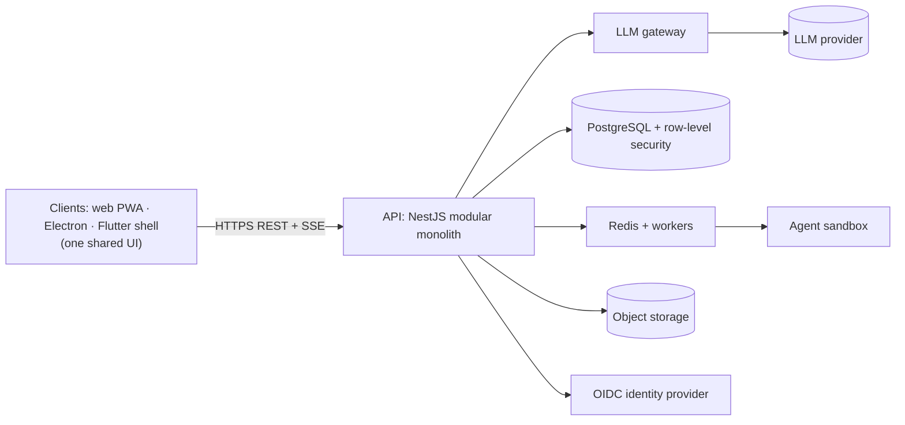

# Architecture (Overview)

**Project:** ChattyOh Inc · **Version:** 0.1 (draft) · **Owner:** Tech Lead · **Status:** Draft
**This is the one-page orientation.** The detailed design, diagrams, data model, quality scenarios and all decision records are in `03-architecture.md`; if the two ever differ, `03-architecture.md` is authoritative.

## 1. Shape of the system

## 2. Design principles

1. **Server is the source of truth;** clients cache and display.
2. **Immutable IDs** for every relationship (ARCH-ADR-003).
3. **Rules live in one server module;** the UI sends actions, never gated fields (ARCH-ADR-004).
4. **Tenant isolation twice:** `tenant_id` in every query and database row-level security (ARCH-ADR-005).
5. **All AI calls go through the gateway** (ARCH-ADR-006).
6. **One UI codebase;** desktop and mobile shells only add a small bridge (ARCH-ADR-007).
7. **Jobs carry their tenant and entity IDs** (ARCH-ADR-008).
8. **Honest by construction:** simulated or preview features are flagged in the API and labeled in the UI.

## 3. Technology (reference stack, to be confirmed by the PoC)

React + TypeScript + Tailwind; NestJS; PostgreSQL with Prisma; Redis with BullMQ; S3-compatible storage; OpenTelemetry; Playwright and Vitest; GitHub Actions; Docker. Details and rationale: `03-architecture.md` sections 3–8 and `rules/cursorrules.md`.

## 4. Key decisions at a glance

| ADR | Decision |
|---|---|
| ARCH-ADR-001 | Modular monolith first |
| ARCH-ADR-002 | OpenAPI-first contract |
| ARCH-ADR-003 | IDs, not names, for relationships |
| ARCH-ADR-004 | Business rules only on the server |
| ARCH-ADR-005 | Tenant isolation with RLS |
| ARCH-ADR-006 | LLM gateway for every model call |
| ARCH-ADR-007 | One UI, platform bridges |
| ARCH-ADR-008 | Idempotent, tenant-bound jobs |
| ARCH-ADR-009 | IndexedDB client cache, versioned |
| ARCH-ADR-010 | Managed OIDC identity |
| ARCH-ADR-011 | Streaming over Server-Sent Events |

## 5. Where the prototype stands

The current prototype is a front-end only application (browser storage, simulated integrations) used to explore the UI and record model. It is **not** this architecture. The migration path is in `03-architecture.md` section 10 and the gaps are in `17-gap-analysis.md`.

## 6. Related documents

Security controls: `04-security-measures.md` · API contract: `packages/contracts/openapi.yaml` · Threats: `07-threat-model.md` · Proof of concept plan: `14-poc-report.md`.
